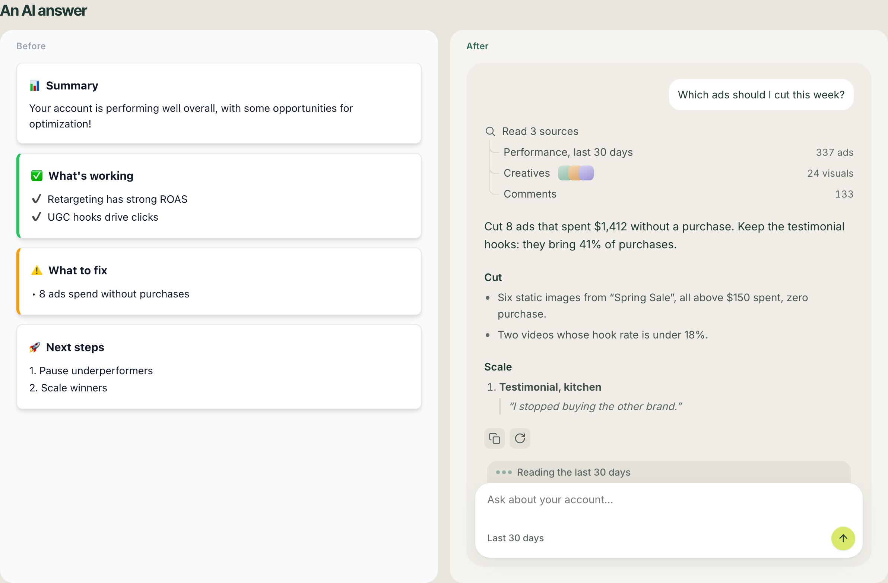
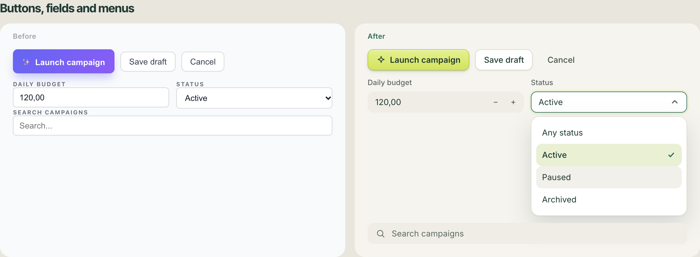
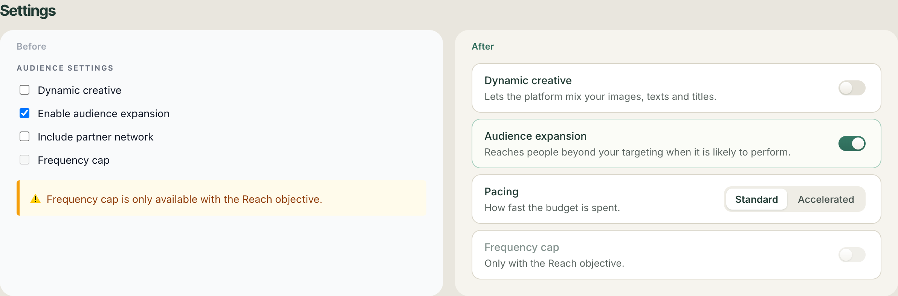
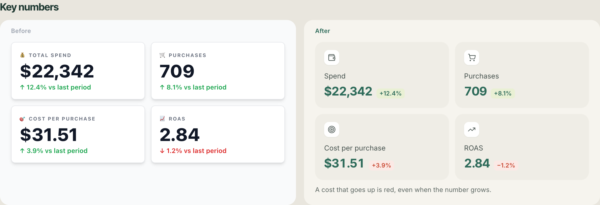
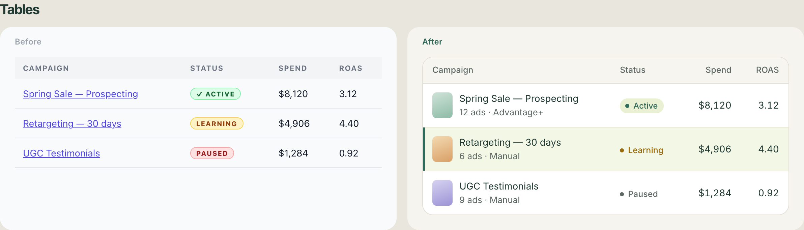
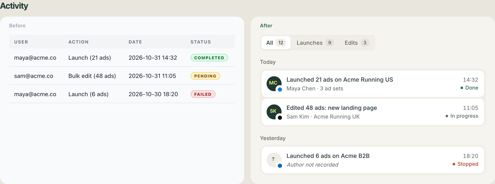
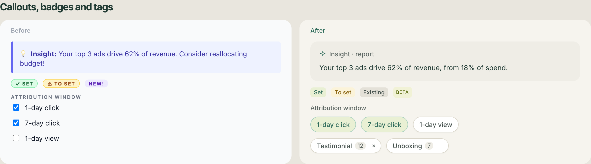
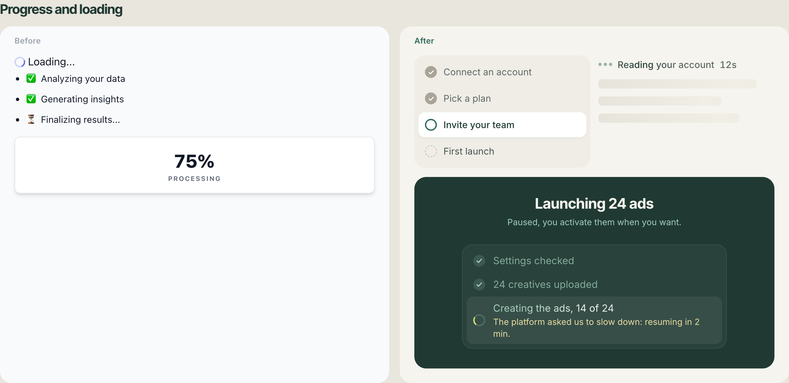
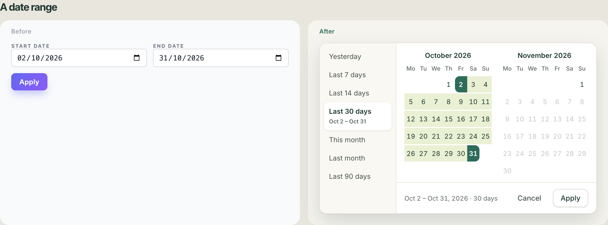

# unvibe

**Make AI-built interfaces look designed.**

> "It's obvious this was made with an AI. I can spot it from 500 km away."
> — a SaaS founder, looking at his own app



`unvibe` is a [Claude Code](https://claude.com/claude-code) skill — and a plain CSS file, and a handful of
React components — that removes the tells of a "vibecoded" UI. It is 140+ small, **measured** details:
the radius of a menu item, the fill of a field, the color of a delta when a cost goes up, the way a
segmented pill glides, how an AI answer should read. Map them to your colors; keep the numbers.

It was extracted from a real two-day polish pass on a production SaaS, where every detail had to survive
two questions from the founder: *can I see the difference?* and *did anything break?*

## Install

```bash
git clone https://github.com/cadjelmedal-blip/unvibe ~/.claude/skills/unvibe
```

Then, in Claude Code, inside your project:

```
this settings page looks vibecoded, make it better
```
```
replace every native select with real menus, no regression
```
```
redo the analytics overview like a professional dashboard, then show me a before/after
```

Claude loads the skill on its own when the request matches; you can also name it ("use unvibe").

## What changes

| | |
|---|---|
|  |  |
| **Buttons, fields, menus.** Relief on the one primary action, filled fields that turn white on focus, a real menu where hover and selection never look alike. | **Settings.** Every yes/no becomes a switch, every setting a row, a locked one says why in gray. |
|  |  |
| **Numbers.** Filled tiles, an icon chip, 24/34 values, a delta colored by meaning: a cost going up is red. | **Tables.** One sentence-case header band, a frame, row hover, a 3px bar on the selected row. |
|  |  |
| **Activity.** A feed, not a table: counted tabs, days, tiles, avatars with a platform badge, time and a status dot. | **Callouts and badges.** Filled zones instead of colored left bars; soft badges; tags you can toggle. |
|  |  |
| **Progress.** Steps as an agent-progress list, skeletons instead of "Loading…", a live journal for long jobs. | **Dates.** One-click presets, two months, the range as one band. |

Open [`demo/index.html`](demo/index.html) to see every pair in a browser.

## What's inside

| Path | |
|---|---|
| [`SKILL.md`](SKILL.md) | the workflow Claude follows: foundations → controls → rebuild key screens → sweep → prove |
| [`references/catalogue.md`](references/catalogue.md) | **every detail with its exact values**, in 17 families |
| [`references/tells.md`](references/tells.md) | how people spot a generated UI, and what replaces each tell |
| [`references/method.md`](references/method.md) | take a professional template, measure its computed styles, map them to your tokens |
| [`references/pitfalls.md`](references/pitfalls.md) | the bugs polish brings: menus inside modals, duplicate keys, lost accessible names, CSS layers, vacuous tests |
| [`references/verification.md`](references/verification.md) | before/after captures and a real no-regression pass |
| [`references/porting.md`](references/porting.md) | token mapping, Tailwind 3 or 4, other frameworks, retrofit order |
| [`assets/css/unvibe.css`](assets/css/unvibe.css) | the drop-in stylesheet: tokens + 24 sections, plain CSS |
| [`assets/react/`](assets/react) | `Select`, `NativeSelect` (drop-in for `<select>`), `Switch`, `SwitchCard`, `SettingsRow`, `Accordion`, `NumberField`, `Segmented`, `RollingNumber`, `ThinkingIndicator`, `DateRangePicker`, `useFlipToFit` |
| [`scripts/`](scripts) | headless-Chrome captures with a console check, and the side-by-side page |

## The rules, short

1. **Selection ≠ action.** A calm color for what is chosen; your loud brand color for the one primary button.
2. **Hover ≠ selected.** Neutral hover; selected = pale tint + a check.
3. **Three surfaces.** Canvas, white for what floats, a darker sunken fill for fields and tiles.
4. **No tracked capitals, no emoji headings, no ✓ in badges, no colored left bars.**
5. **One height and fill per row** of controls.
6. **Yes/no is a switch.** Checkboxes are for lists and consents.
7. **A setting is a row**; a locked one says why, in gray.
8. **Numbers in filled tiles**, deltas colored by meaning.
9. **One table header band everywhere.**
10. **AI answers are text in a thread**, with sources and real elapsed time — never fake progress.
11. **Motion follows a state change**, never a hover.
12. **Never a guessed number, never a decorative control.**
13. **Siblings in the same pass.**
14. **Show visible differences, prove no regression.**

## Without Claude

The CSS and the components work on their own.

```html
<link rel="stylesheet" href="unvibe.css">
<button class="uv-btn uv-btn--primary">Launch campaign</button>
<div class="uv-setting">
  <div class="uv-setting__text"><p class="uv-setting__title">Dynamic creative</p>
    <p class="uv-setting__desc">Lets the platform mix your assets.</p></div>
  <div class="uv-setting__control"><span class="uv-switch"><span class="uv-switch__thumb"></span></span></div>
</div>
```

```tsx
import { Select } from "./Select";            // react-aria-components
<Select aria-label="Status" value={status} onChange={setStatus}
  options={[{ value: "active", label: "Active" }, { value: "paused", label: "Paused" }]} />
```

Map the tokens at the top of `unvibe.css` to your brand: canvas, sunken, ink ×3, selection, accent.

## Develop

```bash
npm install
npm test          # the components, rendered and clicked in jsdom
npm run typecheck
npm run shots     # re-render the README screenshots from demo/index.html
```

## Credits

- Measurements taken on [BoardUI](https://boardui.com)'s components and templates (paid templates were
  reproduced from their principles and our own measurements, not their code).
- Motion gestures (gliding highlight, rolling digits, skeletons) inspired by
  [Arc library](https://github.com/kuratlielia/arc-library) (MIT).
- Accessible primitives by [React Aria](https://react-spectrum.adobe.com/react-aria/).

## License

MIT

---

### En français

`unvibe` est un skill Claude Code qui retire d'une interface tout ce qui fait « généré par une IA » :
plus de 140 micro-détails mesurés (boutons, champs pleins, vrais menus, interrupteurs, lignes de réglage,
tuiles de chiffres, tableaux, fil d'activité, réponses d'IA en conversation, journal de progression,
périodes, mouvement), une feuille CSS prête à l'emploi, des composants React, la méthode (mesurer un gabarit
professionnel et le reporter à ses couleurs) et le protocole avant/après + aucune régression. On garde les
proportions, on change seulement les couleurs.
